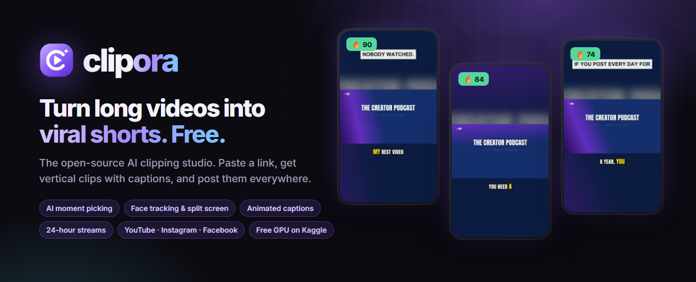
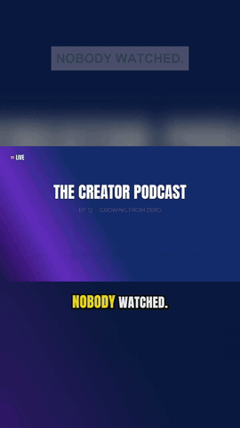
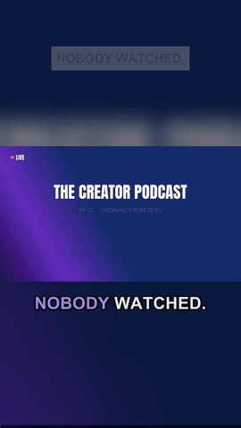
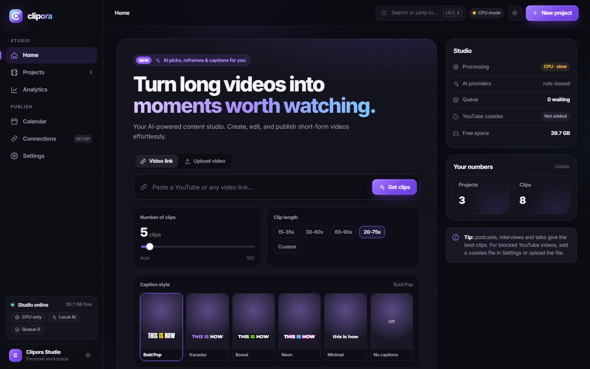
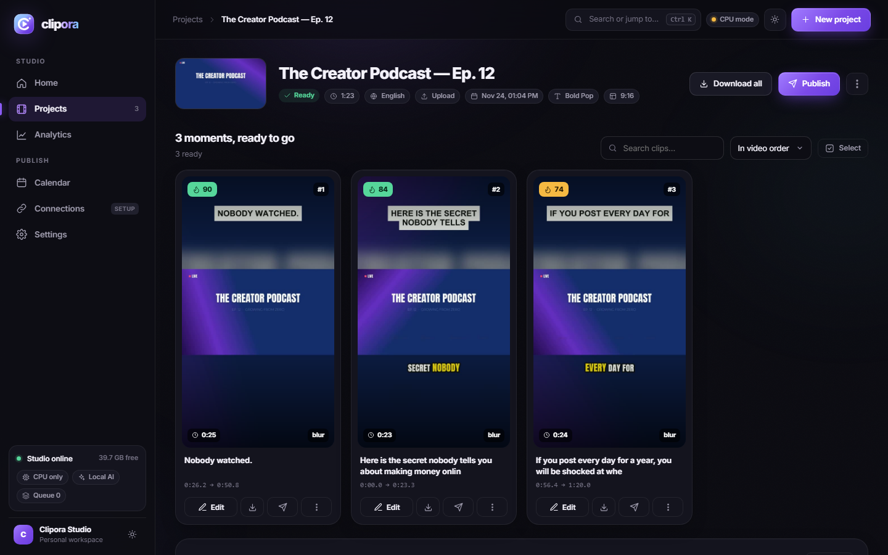
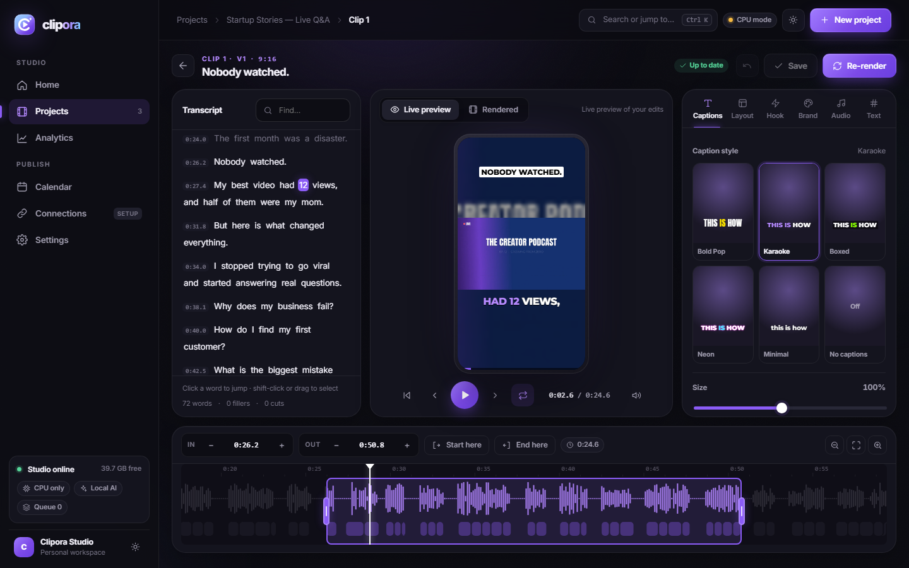
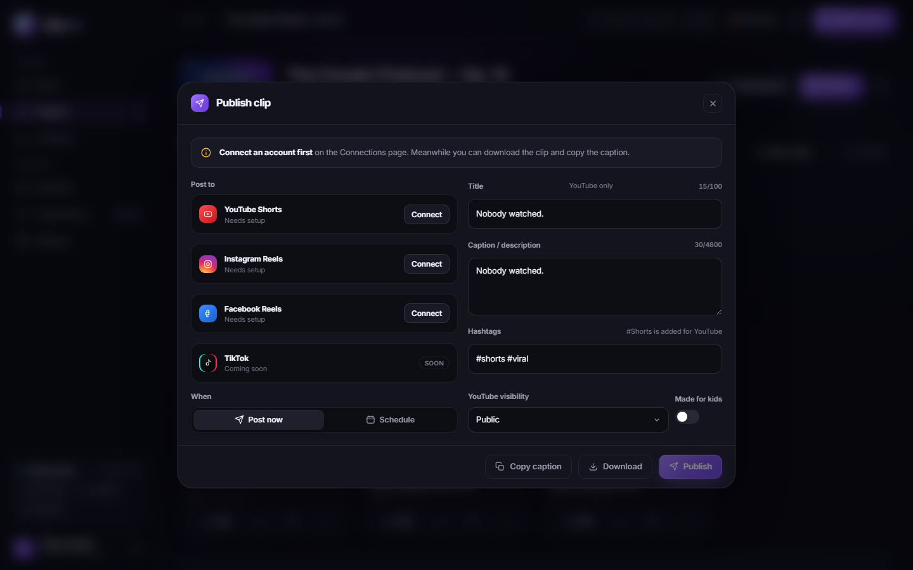
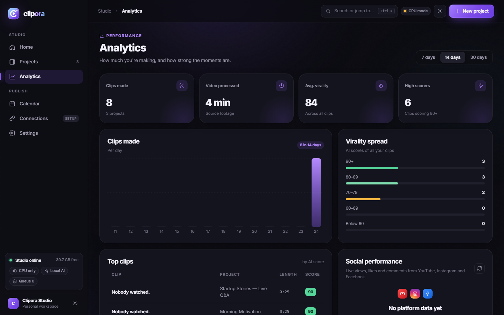
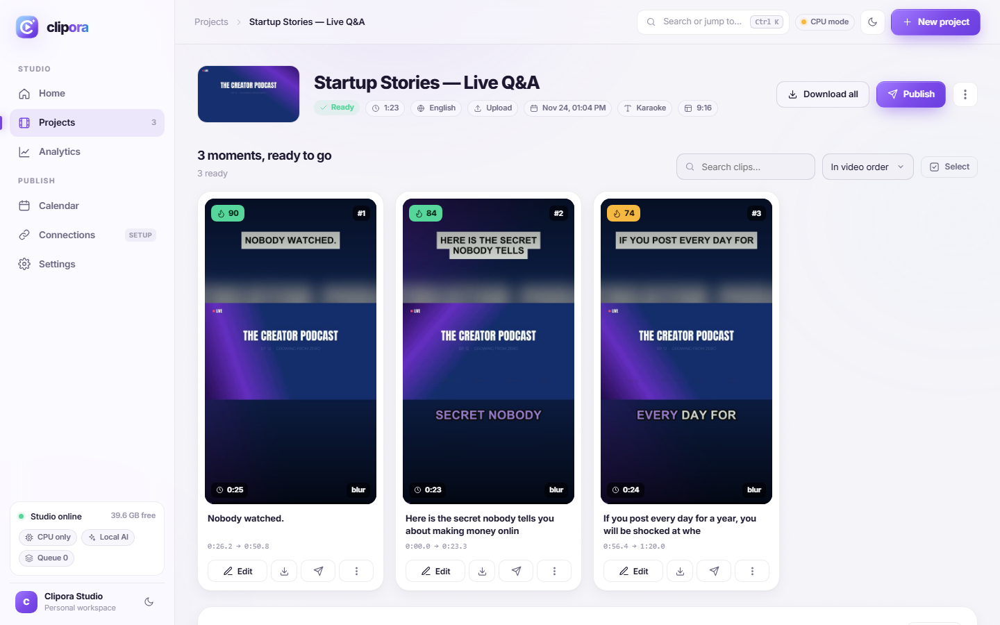
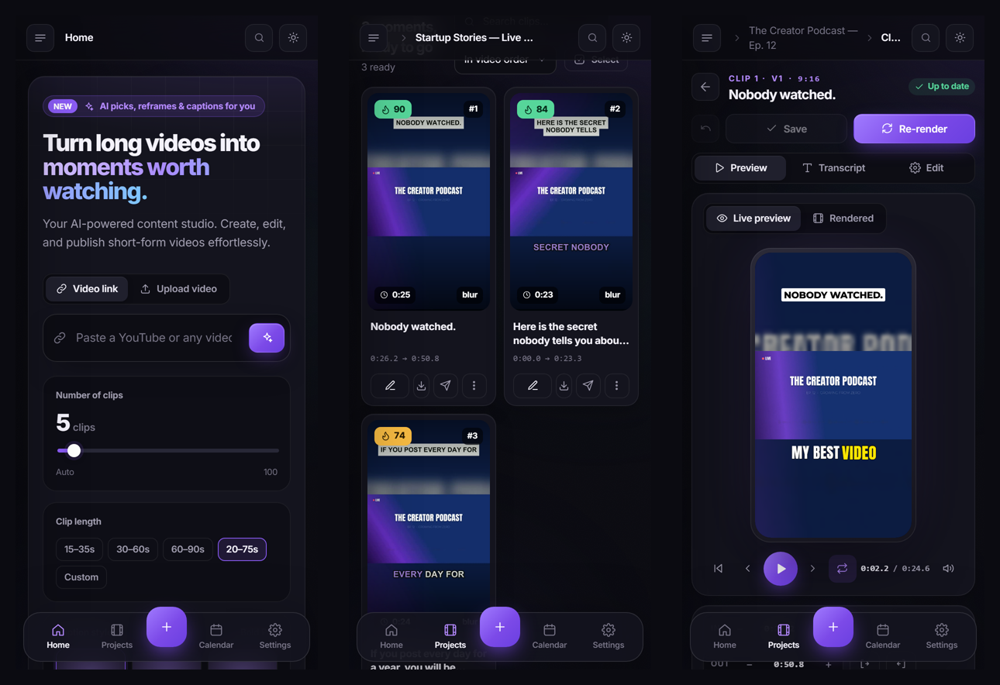

<div align="center">



# Clipora

**The free, open-source AI clipping studio.**<br>
Paste a YouTube link or upload a video — Clipora finds the best moments, reframes them to vertical,<br>
adds animated captions, and posts them to YouTube Shorts, Instagram Reels and Facebook.

[](https://kaggle.com/kernels/welcome?src=https://github.com/haadjunejo/clipora/blob/main/notebooks/Clipora_Launcher.ipynb)
[](https://colab.research.google.com/github/haadjunejo/clipora/blob/main/notebooks/Clipora_Launcher.ipynb)
<br>
[](LICENSE)
[](https://www.python.org)
[](https://github.com/haadjunejo/clipora/actions/workflows/ci.yml)
[](https://github.com/haadjunejo/clipora)

[**Quick start**](#-quick-start) · [**Features**](#-features) · [**Screenshots**](#-screenshots) · [**How it works**](docs/how-it-works.md) · [**Docs**](#-documentation)

</div>

---

## ✨ Why Clipora?

Clipping tools that turn podcasts and streams into Shorts usually cost a monthly subscription.
**Clipora does the same job for free** — on a free cloud GPU (Kaggle or Colab), your own PC, or your own server.
Your videos and keys stay with you.

<table>
<tr>
<td width="33%" align="center"><br><sub><b>Hook title + word-by-word captions</b></sub></td>
<td width="33%" align="center"><br><sub><b>Karaoke style + progress bar</b></sub></td>
<td width="34%">

**One link in → many clips out**

1. 🔗 Paste a link (YouTube, Twitch VODs, 1000+ sites) or upload a file
2. 🗣️ Whisper transcribes every word
3. 🤖 Free AI picks the most viral moments and scores them
4. 🎬 Vertical clips with face tracking and captions
5. ✏️ Fine-tune in the editor
6. 📤 Publish or schedule to YouTube, Instagram, Facebook

</td>
</tr>
</table>

<sub>The clips above were made by Clipora from an original demo video — no edits.</sub>

## 🚀 Features

**AI clipping**
- 🤖 **AI moment picking** with a **virality score** (hook · flow · value · trend) for every clip — plus an
  *AI direction* box ("find the funniest moments", "anything about money")
- 🔁 **Never runs out of AI**: rotates free providers (Groq, Gemini, Cerebras, Mistral, OpenRouter, Claude),
  falls back to a local model on the GPU, then a rule-based picker
- 🎯 **1 to 100 clips** per video, or **Auto** (about one per 4 minutes)
- 📼 **Long stream mode** for 24-hour streams: downloads **audio only**, transcribes with Whisper turbo on
  **every GPU in parallel**, then downloads just the few seconds around each clip
- 🌍 **99 languages** with automatic language detection

**Vertical video that looks right**
- 🙂 **Face tracking** with a smooth "lazy camera"
- 🎮 **Split screen for streams** — facecam on top, gameplay below, switched on automatically when a small
  facecam is detected
- 🌫️ **Blur fill** to keep the whole frame, or a **fixed crop** you drag into place
- 📐 **9:16, 1:1 and 16:9** outputs

**Captions & branding**
- 💬 Animated **word-by-word captions**: Bold Pop, Karaoke, Boxed, Neon, Minimal — size, colours and position
- 🪝 **Hook title** in the first seconds
- ✂️ **Removes filler words** ("um", "uh") and **long silences** automatically
- 🏷️ **Logo watermark** and **progress bar**

**A real editor**
- 📝 **Word-level transcript** — click a word to jump, select words to trim or **cut them out**
- 🎚️ **Timeline with waveform**, drag handles, zoom, undo/redo, keyboard shortcuts
- 👀 **Live 9:16 preview** of captions, hook, logo and layout before you render
- ✍️ **AI rewrite** for titles, descriptions and hashtags

**Publishing**
- 📤 **YouTube Shorts, Instagram Reels, Facebook Reels** — post now or **schedule**
- 📊 **Analytics** with live views, likes and comments
- 🧠 Smart limits: spaces Meta posts to avoid spam blocks, waits for YouTube's daily quota

**Everything else**
- 🌗 Dark and light mode, fully **mobile-friendly**, ⌘/Ctrl+K command palette
- 🔐 Password-protected, single-user studio — **your keys never leave your machine**
- 🧩 Clean **REST API** for automation ([docs/api.md](docs/api.md))

## 📸 Screenshots

<table>
<tr><td colspan="2"><br><sub><b>Home</b> — paste a link or upload, choose clips, length, caption style and layout</sub></td></tr>
<tr>
<td width="50%"><br><sub><b>Project</b> — clips with virality scores, hover to preview</sub></td>
<td width="50%"><br><sub><b>Editor</b> — transcript, live preview, timeline, styles</sub></td>
</tr>
<tr>
<td width="50%"><br><sub><b>Publish</b> — YouTube, Instagram and Facebook at once, now or scheduled</sub></td>
<td width="50%"><br><sub><b>Analytics</b> — your output and real platform stats</sub></td>
</tr>
<tr>
<td width="50%"><br><sub><b>Light mode</b> — every screen comes in dark and light</sub></td>
<td width="50%" align="center"><br><sub><b>What comes out</b> — a ready-to-post vertical clip</sub></td>
</tr>
</table>

<p align="center"><br><sub><b>On your phone</b> — the whole studio works on mobile</sub></p>

## ⚡ Quick start

### Option 1 — Free GPU on Kaggle (recommended, nothing to install)
1. Click [](https://kaggle.com/kernels/welcome?src=https://github.com/haadjunejo/clipora/blob/main/notebooks/Clipora_Launcher.ipynb)
2. Session options → **GPU T4 ×2** and **Internet On**
3. Add a secret **`APP_PASSWORD`** (and free AI keys from [Groq](https://console.groq.com/keys) /
   [Google AI Studio](https://aistudio.google.com/app/apikey))
4. **Run All** → open the `🌍 PUBLIC LINK` it prints

Full guide: [docs/kaggle-colab.md](docs/kaggle-colab.md). Colab works the same way:
[](https://colab.research.google.com/github/haadjunejo/clipora/blob/main/notebooks/Clipora_Launcher.ipynb)

### Option 2 — Your own computer
```bash
git clone https://github.com/haadjunejo/clipora.git && cd clipora
pip install -r requirements.txt            # needs Python 3.10+ and FFmpeg
cp clipora.env.example clipora.env         # add APP_PASSWORD and AI keys
python run_server.py                       # → http://localhost:8000
```

### Option 3 — Docker (NVIDIA GPU)
```bash
docker build -t clipora .
docker run --gpus all -p 8000:8000 --env-file clipora.env -v "$PWD/data:/app/data" clipora
```
Details and all settings: [docs/local-install.md](docs/local-install.md).

## 📚 Documentation

| Guide | |
|---|---|
| [Kaggle & Colab](docs/kaggle-colab.md) | Run free on a cloud GPU, keys, sessions |
| [Install locally / Docker](docs/local-install.md) | Your PC or server, every setting explained |
| [Publish to YouTube](docs/youtube.md) | Google Cloud app, connect, limits |
| [Publish to Instagram & Facebook](docs/instagram-facebook.md) | Meta app, connect, limits |
| [How it works](docs/how-it-works.md) | Pipeline and architecture |
| [REST API](docs/api.md) | Automate Clipora |
| [Troubleshooting](docs/troubleshooting.md) | YouTube blocks, secrets, framing, publish errors |

## 🧰 Built with

[faster-whisper](https://github.com/SYSTRAN/faster-whisper) ·
[yt-dlp](https://github.com/yt-dlp/yt-dlp) ·
[FFmpeg](https://ffmpeg.org) + libass ·
[OpenCV](https://opencv.org) (YuNet face detection) ·
[FastAPI](https://fastapi.tiangolo.com) ·
free LLM APIs (Groq, Google Gemini, Cerebras, Mistral, OpenRouter) ·
fonts [Anton](https://fonts.google.com/specimen/Anton) and [Montserrat](https://fonts.google.com/specimen/Montserrat) (SIL OFL)

## 🗺️ Roadmap

- [x] AI clipping, face tracking, split screen, animated captions
- [x] Editor with transcript, timeline and live preview
- [x] YouTube, Instagram and Facebook publishing + scheduling
- [x] Long stream mode (24 h+)
- [ ] TikTok publishing
- [ ] Background music with auto-ducking, B-roll, zoom on emphasis
- [ ] Fonts for Urdu, Hindi and Arabic captions
- [ ] Multi-user accounts for teams

Ideas? [Open an issue](https://github.com/haadjunejo/clipora/issues/new/choose).

## ⚖️ Use it responsibly

Clipora is a tool — **you are responsible for the content you clip and publish.** Only clip videos you own or have
permission to use. Reposting other creators' content can get videos blocked and accounts restricted, and may
break the law or platform rules. Downloading from YouTube may be against its Terms of Service; use cookies only
from your own accounts. Clipora is not affiliated with YouTube, Google, Meta, Instagram, Facebook or TikTok.

## 🤝 Contributing

Pull requests are welcome! Read [CONTRIBUTING.md](CONTRIBUTING.md) to get started — good first issues include caption
styles, fonts for more languages and TikTok publishing. Found a security problem? See [SECURITY.md](SECURITY.md).

If Clipora saves you time or money, **give it a ⭐** — it helps other creators find it.

## 📄 License

[MIT](LICENSE) © 2026 Haad Junejo and contributors.

<div align="center"><sub>Made with 💜 for creators who'd rather make content than pay for subscriptions.</sub></div>
