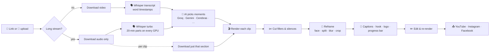

# How Clipora works

## The pieces
| Step | Module | Details |
|---|---|---|
| Download | `clipora/download.py` | yt-dlp with a retry ladder of YouTube clients, cookies support, audio-only and section downloads for long streams. |
| Transcribe | `clipora/transcribe.py` | faster-whisper with word timestamps and voice-activity filtering; long videos are split into parts and run on all GPUs in parallel, each part cached. |
| Pick moments | `clipora/picker.py`, `clipora/llm.py` | The transcript is sent in ~10-minute chunks to free LLMs. The router rotates providers and models, cools down rate-limited ones, falls back to a local model and finally a rule-based scorer — clipping never stops. Each clip gets a virality score with hook / flow / value / trend sub-scores. |
| Render | `clipora/render.py` | Cuts (removed words, fillers, silences), face tracking with OpenCV YuNet + a smoothed "lazy camera", automatic split screen when it finds a small facecam, ASS subtitles burned with libass, logo watermark and progress bar drawn per frame, H.264 export. |
| Jobs | `clipora/jobs.py`, `clipora/pipeline.py` | One folder + `job.json` per project, a single background worker for the GPU, live progress for the website. |
| Publish | `clipora/publish.py`, `clipora/youtube.py`, `clipora/meta.py` | Resumable uploads, a separate publishing worker, Clipora-side scheduling, pacing between Meta posts, YouTube quota handling. |
| Website | `server/app.py`, `web/` | FastAPI + a no-build vanilla JS front end (dark/light, mobile, editor with live preview). |
